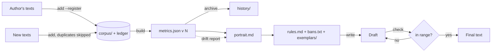

# llm-skills

Agent Skills for LLM coding agents: Claude Code, OpenAI Codex, Cursor, GitHub Copilot,
Gemini CLI, OpenCode, Kiro and anything else that reads the open
[Agent Skills](https://agentskills.io/specification) format.

A skill is a folder with a `SKILL.md` (instructions plus frontmatter that tells the agent
*when* to use it), optional `scripts/`, `references/` and `assets/`. The agent loads only
the name and description at startup, reads `SKILL.md` when a task matches, and opens the
reference files only when a step needs them.

## Contents

- [Skills catalog](#skills-catalog)
- [Installation](#installation)
- [Wiring skills into your agent](#wiring-skills-into-your-agent)
- [writing-style - full manual](#writing-style---full-manual)
- [Repository layout](#repository-layout)
- [Adding a new skill](#adding-a-new-skill)
- [Testing](#testing)
- [Credits and license](#credits-and-license)

## Skills catalog

| Skill | What it does | Needs |
|---|---|---|
| [`writing-style`](skills/writing-style/SKILL.md) | Builds a persistent, measurable portrait of an author's voice from their texts, grows it as new texts arrive, and writes or rewrites text in that voice with a machine check against the author's own range | `python3` 3.9+, standard library only |

## Installation

All methods install the same folder, `skills/writing-style/`.

### Any agent - `npx skills` (fastest)

Uses [vercel-labs/skills](https://github.com/vercel-labs/skills) (Node 22.20+):

```bash
npx skills add tp9imka/llm-skills                                         # interactive
npx skills add tp9imka/llm-skills --skill writing-style -g -a claude-code -y
npx skills add tp9imka/llm-skills --skill writing-style -a codex cursor -y  # project level
```

`-g` installs for your user instead of the current project. `-a` picks agents
(`claude-code`, `codex`, `cursor`, `github-copilot`, `gemini-cli`, `opencode`,
`kiro-cli`, or `'*'`). `--copy` copies instead of symlinking.

### Claude Code - plugin marketplace

```
/plugin marketplace add tp9imka/llm-skills
/plugin install writing-style@tp9imka-skills
```

From a shell: `claude plugin marketplace add tp9imka/llm-skills`, then
`claude plugin install writing-style@tp9imka-skills`. Plugin skills are namespaced -
`/writing-style:writing-style` - and also trigger automatically from the description.

### Manual copy - any agent

```bash
git clone https://github.com/tp9imka/llm-skills
cp -R llm-skills/skills/writing-style <skills-dir>/
```

| Agent | Project `<skills-dir>` | User `<skills-dir>` |
|---|---|---|
| Claude Code | `.claude/skills/` | `~/.claude/skills/` |
| OpenAI Codex | `.agents/skills/` | `~/.agents/skills/` |
| Cursor | `.agents/skills/` or `.cursor/skills/` | `~/.agents/skills/` or `~/.cursor/skills/` |
| GitHub Copilot (VS Code, CLI, coding agent) | `.github/skills/`, `.agents/skills/` or `.claude/skills/` | `~/.copilot/skills/` or `~/.agents/skills/` |
| Gemini CLI | `.gemini/skills/` or `.agents/skills/` | `~/.gemini/skills/` or `~/.agents/skills/` |
| OpenCode | `.opencode/skills/`, `.agents/skills/` or `.claude/skills/` | `~/.config/opencode/skills/` or `~/.agents/skills/` |
| Kiro | `.kiro/skills/` | `~/.kiro/skills/` |

`.agents/skills/` is read by Codex, Cursor, Copilot, Gemini CLI and OpenCode. For a repo
used with several agents, install there and symlink for Claude Code or Kiro:
`ln -s ../.agents/skills/writing-style .claude/skills/writing-style`.

- **Codex** - invoke with `$writing-style`, list with `/skills`.
- **Gemini CLI** - `gemini skills install https://github.com/tp9imka/llm-skills --path skills/writing-style`
  also works; manage with `/skills list|reload`.
- **Kiro** - custom agents load skills only if their `resources` include
  `skill://.kiro/skills/*/SKILL.md`. The IDE importer wants the skill folder URL, not
  the repo root.
- **No skill support** - any agent that reads files and runs a shell can follow
  `skills/writing-style/SKILL.md` when pointed at it (next section).

### Check the install

Start a new session and ask *"What skills do you have for writing style?"* - the agent
should name `writing-style`. Then:

```bash
python3 <skills-dir>/writing-style/scripts/style.py -h
```

## Wiring skills into your agent

Skills trigger from their description. For reliable use in a team repo, add a pointer to
the file your agent always reads (`AGENTS.md`, `CLAUDE.md`, `GEMINI.md`,
`.github/copilot-instructions.md`, `.cursor/rules/*.mdc`):

```markdown
## Writing style

- Voice profiles live in `profiles/<who>/` (built by the `writing-style` skill).
- Writing or rewriting user-facing text in a profiled voice (posts, release notes,
  emails, review comments): use the `writing-style` skill, read `profiles/<who>/rules.md`
  fresh, and run its `check` with the matching `--register` before presenting the
  draft. Report the final check summary and any `[fill: ...]` gaps.
- New texts by a profiled author: add them with the skill's update workflow.
- No profile for the requested voice => say so and offer to build one.
```

For agents without native skills, make the path explicit:

```markdown
Before any writing-style task, read `.agents/skills/writing-style/SKILL.md` and follow it.
The script is `.agents/skills/writing-style/scripts/style.py`.
```

Gate generated text in CI - `--strict` exits 1 when the draft leaves the author's range,
uses a banned phrase or clusters weak tells:

```bash
python3 .agents/skills/writing-style/scripts/style.py check profiles/acme \
  docs/release-notes.md --register release-notes --strict
```

## writing-style - full manual

### What it is

`writing-style` captures how a specific author writes, keeps that knowledge in a folder
that grows over time, and reproduces it on new text. It is **not a humanizer**. A
humanizer pushes text toward a generic "human" norm; this skill reproduces one measured
author, including the habits a humanizer would strip (dashes, lists, a pet word). The
two work together: clean machine slop first, then apply the voice.

### Why not just "write like X"

Shown a couple of examples, a model copies topics and pet words, not manner, and it
forgets everything when the session ends. Here the voice is a **profile folder** with
three layers, each verified its own way:

| Layer | Filled by | Lives in | Verified by |
|---|---|---|---|
| A. Measured | the script | `metrics.json` | recomputation, `check` |
| B. Voice map | the agent, reading the corpus | `portrait.md` | evidence + confidence on every claim |
| C. Generation rules | the agent, from A and B | `rules.md`, `bans.txt`, `exemplars/` | the text written from them |

Layer A measures sentence and paragraph geometry, burstiness, lexical variety,
readability, contractions, marker groups per 1000 words (pronouns, fillers, hedges,
boosters, obligation, officialese), punctuation and formatting - and for each feature
the author's **own spread across texts** (p10 / median / p90). It also stores a
**function-word model** (Burrows' Delta), a topic-independent fingerprint of how the
author uses words like *the, but, just, would*.

The spread matters more than the average: a draft is compared with the author's range,
so normal variation is not flagged.

### The profile lifecycle



| Job | Trigger | Result |
|---|---|---|
| **Build** | "profile my writing style" + sample texts | `profiles/<who>/` complete |
| **Update** | "add these posts to my profile" | new version, drift report, revised portrait |
| **Write** | "write this in my voice", "rewrite in the acme style" | full text + check result |
| **Check** | "does this sound like me?" | deviation report |

### Registers

One person writes a code review differently from a public post. Add each kind of text
under its own register (`--register posts`, `--register review-comments`,
`--register status-updates`). `build` measures each register separately when it has 8+
texts of 80+ words, `check --register` compares against the right range, and
`rules.md` keeps one block per register with only what differs.

### Walkthrough for humans

**1. Gather texts.** Your own, by register. Remove guest posts and quotes. Aim for
20 000+ characters and 8+ texts of 80+ words per register. Accepted: a folder of
`.md`/`.txt` (one text per file), one file with texts separated by `---` or two blank
lines, or a Telegram Desktop export of one channel.

**2. Ask the agent to build the profile:**

> Build my writing-style profile as `ivan` from `posts/` (register posts) and
> `reviews.md` (register review-comments).

The agent runs `init`, `add`, `build`, reads the corpus, writes `portrait.md` and
`rules.md`, seeds `exemplars/`, and validates on held-out texts. Review `rules.md`: it
is the card every future draft is written from.

**3. Write:**

> Write a LinkedIn post from these notes in the `ivan` voice, register posts: ...

The agent locks the facts, reads `rules.md`, `bans.txt` and exemplars, writes, runs
`check`, fixes deviations, and shows the full text with the check summary and any
`[fill: ...]` gaps.

**4. Grow it.** Every few weeks:

> Add `new-posts/` to my `ivan` profile.

The agent adds the texts (duplicates skipped), rebuilds, reads the drift report, and
revises the portrait and rules where the evidence changed. Every version stays in
`history/`, every change in `CHANGELOG.md`.

**5. Teach it by rejection.** When you reject a draft, let the agent save it to
`exemplars/` as an anti-exemplar with the reason. When something "isn't you", say so -
it becomes a rule or a ban.

### Running the script by hand

```bash
S=llm-skills/skills/writing-style/scripts/style.py

python3 $S init   profiles/ivan --name Ivan
python3 $S add    profiles/ivan posts/      --register posts --describe "LinkedIn posts"
python3 $S add    profiles/ivan reviews.md  --register review-comments
python3 $S add    profiles/ivan --telegram result.json --register chat
python3 $S build  profiles/ivan --ngrams 25 --openers 10
python3 $S status profiles/ivan
python3 $S check  profiles/ivan draft.md --register posts
python3 $S check  profiles/ivan draft.md --register posts --strict   # exit 1 on deviations
python3 $S metrics some-folder/ --json quick.json                     # one-off, no profile
```

### Reading `build` output on an update

Illustrative numbers:

```
profile ivan v3: 64 texts (+12), 81234 chars, registers: posts=40, review-comments=24

drift vs v2 (median moved past the old band or >20%):
  contractions_per_1000            31.2 => 44.8      +44%  outside old band
  sentence_words_median              11 => 9         -18%

ban conflicts - phrases in bans.txt the author actually uses (the profile wins: ...):
  'robust': 6x in 5 of 64 texts
```

Drift is a question, not an error: the voice changed, or the new texts belong to another
register, or the batch was small. The update workflow says how to decide.

### Reading `check` output

Illustrative numbers, real format:

```
draft: 254 words, 21 sentences - against register 'posts'

feature                             profile     draft   deviation
!! officialese - not in profile     0.0-0.0     19.69   foreign
!! sentence_words_median               6-11      17.0   +55% past edge
ok contractions_per_1000        36.76-77.84      51.2   in range
...
out of tolerance: 4 of 19
function-word delta: 1.41 (author's own texts 0.40-1.18) - further than the author's own texts
  passages furthest from the author (rolling windows):
    line 7: delta 1.92 - 'In order to facilitate the rollout, the team'

banned phrases: 1
  line 3: 'delve'

weak tells: 3 - cluster, rewrite these
  line 5: 'crucial'
  line 5: 'seamless'
  line 9: 'robust'

unresolved placeholders: 1 - [fill: p95 latency]
```

Fix order: banned phrases => foreign traits => weak-tell clusters => drifting passages
=> largest `past edge` => leave placeholders visible for the human. Fix the text, never
the thresholds. Full rules: [`metrics-reference.md`](skills/writing-style/references/metrics-reference.md).

### Calibration

On the synthetic corpus in `tests/`, a held-out text by the same "author" stays within
the author's Delta band and trips few features; a bureaucratic draft trips most, with
`officialese` and `obligation` flagged as foreign. The original Russian tool reported a
similar split on a real 91-post channel (2-6 deviations out of 25-28 features for the
author's own posts, 12 of 14 for a bureaucratic draft). The English lists here are not
yet calibrated on a real English corpus - the build workflow's held-out check gives you
that number for your own profile.

### Limits

- **English only.** Marker lists, contractions, abbreviations and Delta function words
  are English. Geometry, punctuation and formatting work in any language.
- **No part-of-speech analysis** - standard library only, by design.
- **Delta says "unlike this author", not "written by someone else".** It is calibrated
  on the author's own spread, not on other authors.
- **Small corpora are shaky** (under 20 000 chars, or under 8 texts of 80+ words per
  register). The script warns; the portrait must say so.
- **Short drafts are noisy.** Under ~120 words trust only large deviations; under 80
  words Delta is not measured.
- **AI tells date.** The default ban list is versioned; review it every few months.
- **Style and content can't be fully separated** - topic-bound traits go to "Content
  leakage" and don't transfer.
- **Someone else's voice.** Profile your own texts, or a voice you are authorized to
  write as (a brand, a team). Imitating another person reads as parody at best and
  forgery at worst.


### Files in the skill

```
skills/writing-style/
├── SKILL.md                         entry point: jobs, profile layout, rules
├── scripts/style.py                 init / add / build / status / check / metrics
├── references/
│   ├── build-workflow.md            create a profile, step by step
│   ├── update-workflow.md           grow a profile, handle drift
│   ├── writing-workflow.md          write, check, fact-lock, report
│   ├── profile-layers.md            what goes where and why, research basis
│   └── metrics-reference.md         every feature, threshold and check rule
└── assets/
    ├── portrait-template.md         layer B template
    ├── rules-template.md            layer C voice card template
    └── default-bans.txt             tiered, dated AI-tell list
```

## Repository layout

```
llm-skills/
├── README.md
├── AGENTS.md                        rules for agents editing this repo
├── LICENSE
├── .claude-plugin/marketplace.json  Claude Code marketplace manifest
├── skills/
│   └── writing-style/
└── tests/
    └── test_writing_style.py
```

## Adding a new skill

1. Create `skills/<name>/SKILL.md`. `<name>`: lowercase letters, digits, hyphens, up to
   64 chars, equal to the folder name.
2. Frontmatter: `name` and `description` are required. The description (max 1024 chars)
   says what the skill does **and when to use it**, with phrases a user would type - it
   is all the agent sees before deciding to load the skill. Optional: `license`,
   `compatibility`, `metadata` (string values). Stick to standard fields so the skill
   works in every agent.
3. Keep `SKILL.md` short (spec limit 500 lines; this repo aims under 100). Detail goes in
   `references/`, one level deep, linked by relative path.
4. Scripts go in `scripts/`, called by absolute path from the skill folder
   (`${CLAUDE_SKILL_DIR}` in Claude Code). Prefer the standard library; declare any
   dependency in `compatibility`.
5. Add a plugin entry in `.claude-plugin/marketplace.json` and a catalog row above.
6. Add tests in `tests/`, then run the commands under [Testing](#testing).

Skeleton:

```markdown
---
name: my-skill
description: What it does. Use when the user asks to "...", "...", or when <situation>.
license: MIT
---

# my-skill

<one-paragraph purpose>

## Workflow
1. ...

## Rules
- ...
```

## Testing

```bash
python3 -m unittest discover tests -v    # script behavior, no dependencies
claude plugin validate .                 # marketplace manifest (needs Claude Code)
```

## Credits and license

MIT, see [LICENSE](LICENSE).


| Idea | Source |
|---|---|
| Three layers, per-text bands, content leakage, Telegram corpus | [style-skills](https://github.com/vyacheslav-startsev/claude-plugins) by Vyacheslav Startsev |
| Topic stripping, explicit "absent" fields | [style portrait gist](https://gist.github.com/miolamio/5224e81663f5140107d60132c2f61db2) by Anton Vdovichenko |
| Function-word Delta, leave-one-out calibration, rolling windows | Burrows (2002); [faststylometry](https://github.com/fastdatascience/faststylometry), [stylo](https://github.com/computationalstylistics/stylo) |
| Tiered tells (strong alone, weak in clusters), fact-lock, voice sample beats generic rules | [blader/humanizer](https://github.com/blader/humanizer), [humanizer-ru](https://github.com/ilyautov/humanizer-ru) |
| Tells as dated clues, not proof | [Wikipedia: Signs of AI writing](https://en.wikipedia.org/wiki/Wikipedia:Signs_of_AI_writing) |
| Contrast-pattern regexes ("not X, but Y") | [antislop-sampler](https://github.com/sam-paech/antislop-sampler) |
| Per-genre guides loaded on demand; fresh-reader validation | [anthropics/skills](https://github.com/anthropics/skills) `internal-comms`, `doc-coauthoring` |
| Short voice card read fresh every time, `[fill: ...]` gaps, exemplars with "why", rejected drafts as anti-exemplars, per-occasion registers | the author's own writing workflow |

